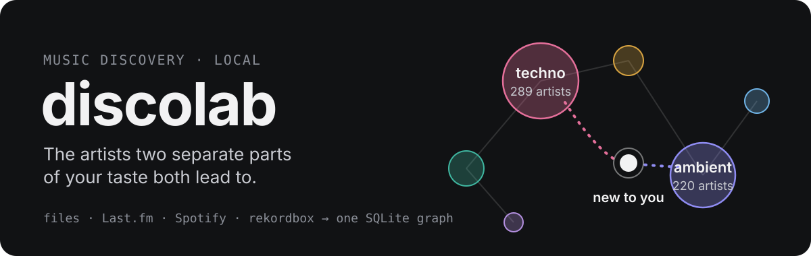
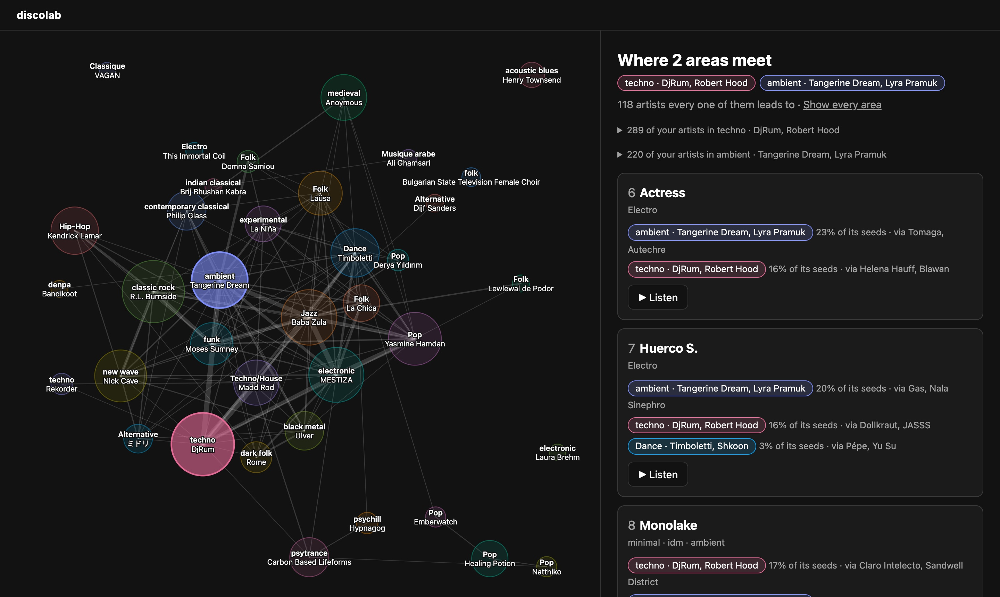

<p align="center">
  
</p>

discolab builds a taste graph from what you listen to, splits it into areas of taste, and asks Last.fm which artists each area leads to. The main list ranks the artists you do not have that two different regions of your taste reach, by the weaker of the two votes. The graph and the app run locally, in one SQLite file and one browser page; the lookups go to Last.fm, and Listen goes to YouTube.

<p align="center">
  
</p>

Two areas selected on the map, techno and ambient: the list shows what both lead to, with the seeds that voted for each artist.

## How it works

```mermaid
flowchart LR
  sources["Audio files<br>Last.fm scrobbles<br>Spotify playlists<br>rekordbox"] --> graph["Artist graph<br>credits, shared albums,<br>playlists, sessions"]
  graph --> areas["Areas<br>Louvain over your<br>own artists"]
  areas --> expand["Last.fm similar artists<br>for each area's seeds"]
  expand --> rank["Ranked discoveries<br>voted for by<br>two separate regions"]
  rank --> app["Map and list<br>on localhost"]
```

One seed suggesting an artist says almost nothing. Two unrelated parts of your taste agreeing on the same artist says a lot, so discoveries are ranked by the weaker of the two votes.

## Requirements

- Python 3.11 or newer, and `uv`
- No service to run: the graph is one SQLite file, `out/discolab.db`
- `sqlcipher`, for the rekordbox step: `brew install sqlcipher`. Without it that step is skipped and every other source still runs.

## Setup

1. `uv sync`
2. `cp .env.example .env`, then set `DISCOLAB_LIBRARY_ROOTS` to your music folders separated by `:`
3. `uv run discolab spotify-login`, once, if you want Spotify in the graph
4. `uv run discolab ingest`

## The loop

| Step | Command | What it does |
|---|---|---|
| 1 | `discolab ingest` | Aggregate every source, resolve the names, load the graph, then attach rekordbox's BPM, keys and tags |
| 2 | `discolab guess` | Derive taste communities, expand past them, open the app |
| 3 | `discolab tags` | Last.fm's genre tags for the artists no tag has described |

```
uv run discolab ingest
uv run discolab guess
uv run discolab tags
```

Every source is read unless it is switched off or unconfigured, so `ingest` needs no flags. `--no-lastfm` and `--no-spotify` skip one. A source missing its credentials is reported and skipped rather than stopping the run.

The three steps are not optional and not ordered by taste: `guess` reads communities that `ingest` produced, and `expand` inside it needs Last.fm.

| Command | Does |
|---|---|
| `discolab derive` | Rebuild artist edges, communities and islands on their own |
| `discolab expand` | Ask Last.fm for artists similar to each cluster centre |
| `discolab tags` | Fill in Last.fm's genre tags where no other source has one |
| `discolab serve` | Serve the app on `http://127.0.0.1:8765/` |
| `discolab clusters` | List the taste clusters |
| `discolab stats` | Artist, track, edge and island counts |
| `discolab prune` | Drop unplayed tracks and the artists left with none |
| `discolab reset --yes` | Empty the database |
| `discolab spotify-login` | Authorise against Spotify once, caching the refresh token |

## What rekordbox adds

`ingest` reads the BPM, the musical key and the DJ's own tags out of `master.db` and writes them onto the tracks already in the graph.

It is local and it costs nothing beyond one binary: no network, no account, and the only requirement is `sqlcipher`, since rekordbox 6 encrypts the database with a published constant key. Without it the step reports why and the rest of the run continues.

| Written | From |
|---|---|
| `track.bpm` | `djmdContent.BPM`, stored as a hundredth so 12700 is 127.00 |
| `track.musical_key` | `djmdContent.KeyID` through `djmdKey.ScaleName` |
| `track.rating`, `track.dj_plays` | `djmdContent.Rating`, `DJPlayCount` |
| `track_tag` | `djmdMyTag` through `djmdSongMyTag` |
| `artist_tag` | the union of an artist's tracks, weighted by count |

The join is on the file path, folded to NFC first. The filesystem returns decomposed accents and rekordbox composed ones, so without that fold an exact join matches nothing while looking correct.

Measured on one library: 1,832 rows, every one with a BPM and a key, and 1,543 carrying at least one tag.

The tags are a curated taxonomy spanning style and region, so they filter far more sharply than Last.fm's: `Minimal / Deep Tech`, `Raw / Deep / Hypnotic`, `Peak Time / Driving`, `Hard Techno`, `Maghreb & Mashriq`. With BPM and key alongside them, a mix-oriented query is a filter rather than a guess.

`--no-rekordbox` skips the step.

## The app

```
uv run discolab serve
```

It reads the database on every page load, so a rerun of `guess` shows on refresh. `--port N` moves it, `--no-open` leaves the browser alone. It binds to localhost only.

| Side | Shows |
|---|---|
| Left, the map | One bubble per area of at least 5 artists, sized by its artist count, each in its own colour and named by its most distinctive style. Areas of one region are drawn together. A line joins two areas that share discoveries, thicker when they share more. The wheel zooms, a drag pans, a double-click resets |
| Right, the list | Every artist you do not have that two regions vote for, best first, with every area that voted and the seeds that led there |

A click on a bubble, or on an area chip in the list, selects that area; a second click unselects it. One selected area narrows the list to its discoveries. Several narrow it to the artists every selected area votes for, ranked by the weakest of those votes.

`Listen` on a discovery searches YouTube for one official upload and embeds it. Results are kept in `videos.json` beside the database, so an artist is searched once.

| Rule | Reason |
|---|---|
| Single tracks only | Sets, mixes and full albums are rejected on title, or on a length above 15 minutes |
| The artist's own channel, or their distributor's Topic channel | A name search returns fan re-uploads first |
| A verified channel only when the title opens with the artist's name, and only when the artist has no channel of their own | Verified businesses re-upload anything |
| Several uploads per artist, ranked by channel trust | An upload that blocks embedding is replaced by the next one |

An artist with no official upload gets a link to a YouTube search rather than a re-upload.

## Configuration

| Variable | Default | Meaning |
|---|---|---|
| `DISCOLAB_LIBRARY_ROOTS` | none | Library folders, separated by the OS path separator |
| `DISCOLAB_DB` | `out/discolab.db` | The SQLite file holding the graph, created on first use |
| `LASTFM_API_KEY` | none | Skips Last.fm when unset. The key alone is enough; the shared secret is not used |
| `LASTFM_USERNAME` | none | The account whose scrobbles to read |
| `SPOTIFY_CLIENT_ID` | none | Skips Spotify when unset |
| `SPOTIFY_CLIENT_SECRET` | none | |
| `SPOTIFY_REDIRECT_URI` | `http://127.0.0.1:8888/callback` | Must match the app's registered URI exactly |
| `SPOTIFY_CALLBACK_PORT` | `8888` | Must match the port in the redirect URI, since the container publishes it |
| `SPOTIFY_TLS_CERT` | none | Certificate for an https redirect URI |
| `SPOTIFY_TLS_KEY` | none | Its key |

## Graph model

| Table | Key | Holds |
|---|---|---|
| `artist` | normalised name | Name, `external` for expansion artists, styles and labels as JSON lists |
| `track` | normalised artist plus normalised title | `artist_key`, paths as a JSON list, plays, rekordbox facts |
| `container` | album tag, subfolder, playlist or session | |
| `contains` | container, track | Written by `ingest` |
| `credited` | artist, track, role | Role is `collab`, `feature`, or `remix`. Written by `ingest` |
| `similar` | seed, artist | Last.fm's match score. Written by `expand` |
| `collaborates`, `co_occurs` | one row per unordered artist pair | Rebuilt by `derive` |
| `track_tag`, `artist_tag` | track or artist, tag | rekordbox tags, and their count per artist |

Derived columns on `artist`, rebuilt by `derive`: `degree`, `community`, `component`, `component_size`, `bridge_score`, `area`.

## How the edges are found

Filenames are read as `Artist - Title`. Credits are parsed from that text.

| Source | Example | Edge |
|---|---|---|
| Multiple artists in the name | `Dekel; Eukai - Deepnotech` | collaboration |
| Remix or edit credit | `Baiuca - Meigallo (Matias Aguayo remix)` | remix |
| Feature credit | `AMMAR 808 feat. Sofiane Saidi - Degdega` | feature |
| Version words | `(Original Mix)`, `(Extended Mix)` | dropped, not a person |
| Shared container | two artists on one album tag | co-occurrence |
| A listening session | two artists played within thirty minutes | co-occurrence |

## What Last.fm adds

Last.fm scrobbles give two things the files cannot.

Play counts, from `user.gettoptracks`, written to `Track.plays`. That is the first real play signal in the graph, so unplayed becomes definable.

Listening sessions, from `user.getrecenttracks`. Scrobbles are grouped into sessions split by a thirty minute gap, and each session becomes a container. Containers are what the co-occurrence edges are built from, so a session turns real listening into artist to artist edges. A library of loose single tracks has almost no albums, which is why own-data co-occurrence contributed one edge before this.

Reading more history reads more sessions: `--scrobbles N` sets how many recent scrobbles to read, and `LastfmProvider.top_pages` caps the top-tracks pagination.

## What Spotify adds

Spotify contributes every playlist plus liked songs, and two things come from them.

Playlist membership becomes a container, so artists sharing a playlist co-occur. Liked songs is one large container, and it is capped like any other, so it only contributes when it is small enough to mean something.

Ownership. A track in a playlist is a track you know, whether or not a file for it exists on disk.

## The Spotify login

```
uv run discolab spotify-login              # callback served by this process
uv run discolab spotify-login --container  # callback served by the compose service
```

Both need `SPOTIFY_CLIENT_ID` and `SPOTIFY_CLIENT_SECRET`, a registered redirect URI matching `SPOTIFY_REDIRECT_URI` exactly, and your Spotify account added under the app's **Settings → User Management**. A new app is in development mode and only listed users can authorise, so without that step the login fails with a 403.

Spotify requires HTTPS for redirect URIs except on a loopback address, where plain HTTP is permitted, and it rejects `localhost` as a hostname. So `http://127.0.0.1:8888/callback` works without a certificate, and it keeps the callback off the network entirely.

For an HTTPS redirect URI, either point `SPOTIFY_TLS_CERT` and `SPOTIFY_TLS_KEY` at a certificate, or use `--container`, which runs the callback as the `spotify-callback` compose service. The container needs an HTTP or HTTPS port published to match the redirect URI. It binds all interfaces because a published port cannot reach a container's loopback, which is what `SPOTIFY_BIND_HOST` controls.

The refresh token is cached in `out/spotify-token.json`, which is not committed.

Two limits come from Spotify rather than from here.

A development-mode app can read its own playlists but not the contents of a public playlist owned by someone else. Those return 403 on their items, and the count of them is reported at ingest instead of being skipped silently. Reading them needs Extended Quota review. Playlists you own are unaffected.

The playlist contents endpoint is `/playlists/{id}/items`; `/tracks` was withdrawn and now returns 403. Playlist entries wrap the track under `item`, while saved tracks use `track`, and both are read.

## Expanding beyond your own music

Ranking artists that bridge the graph only returns artists you already have, because every artist came from your own data. Those bridges are seeds, not answers.

`discolab expand` takes the most central member of each taste cluster, asks Last.fm for similar artists, and writes the ones you do not have as external artists.

One seed suggesting an artist says almost nothing, and that is most of a similarity list. What matters is two separate tastes leading to the same artist, so the discoveries are ranked by the weaker side of that intersection.

| Step | Rule |
|---|---|
| Areas | Louvain at resolution 1.0 over your own artists only, written as `artist.area`. Expansion artists are left out, since one linking two areas merges them |
| Regions | Louvain at resolution 0.3 over the same graph. An area belongs to the region most of its artists fall in |
| Eligible area | At least 5 seeds |
| An area's vote | At least 2 of its seeds name the artist; support is the share of its seeds that do |
| Rank | The second-best region's support, a region taking its best area's, highest first. Two areas of one region are one taste, so an artist only they vote for is left out of the main list but still shows when you select them |

Measured over 200 seeds: 3,778 suggestions, 1,028 already in your corpus, and agreement of 5 seeds for 4 artists, 4 for 8, 3 for 46, 2 for 238, and 1 for 2,079. The single seed tail is the low quality material and it does not reach the app.

## Genres

```
uv run discolab tags
```

Genres come from Last.fm's own tags, written as a property rather than as graph nodes.

| Written | From |
|---|---|
| `Artist.styles` | the artist's top Last.fm tags, strongest first |
| `Artist.lastfm` | whether the artist has been asked about |

It resumes: every artist asked is marked, so the next run continues where the last stopped. Tags cost one request per artist, where `expand` gets twenty, so the walk is paced at four a second and covers twelve thousand artists in about fifty minutes.

**Only words that describe a sound.** Last.fm's top tags mix genres with places, platforms and moods — `netherlands`, `bandcamp`, `relaxing`. Those are dropped, by list and by the `-ese` and `-ish` endings most demonyms share. A tag also has to appear on eight listeners and hold a tenth of the artist's top tag, or it is one person's word.

Tags name a sound more precisely than a catalogue does: `hardgroove`, `acidcore`, `industrial techno`, `schranz`.

## Known limits

- Edges come only from title credits and shared containers. A library of single-artist albums produces almost none.
- Container edges are ignored for containers holding fewer than 2 or more than 80 distinct artists, since the wide ones make everything co-occur.
- Entity resolution is name-based. Aliases such as `Sterac aka Steve Rachmad` and `Sterac, Steve Rachmad` remain separate artists.
- A verified YouTube channel that curates rather than releases is accepted when the title opens with the artist's name.
- Deezer genres are coarse. Fine styles such as `IDM` or `Breakbeat` are not available from any source that answers faster than sixty requests a minute.

## Exploring in SQLite

```
sqlite3 out/discolab.db
```

```sql
-- Islands and their size
SELECT component, component_size, group_concat(name, ', ') AS artists
FROM artist WHERE component >= 0
GROUP BY component ORDER BY component_size DESC LIMIT 10;
```

```sql
-- Everything one artist co-occurs with
SELECT other.name, pair.weight
FROM artist a
JOIN co_occurs pair ON a.key IN (pair.a, pair.b)
JOIN artist other ON other.key IN (pair.a, pair.b) AND other.key <> a.key
WHERE a.name = 'El Búho';
```

## Development

```
uv run pytest
```

## License

MIT. See [LICENSE](LICENSE).
